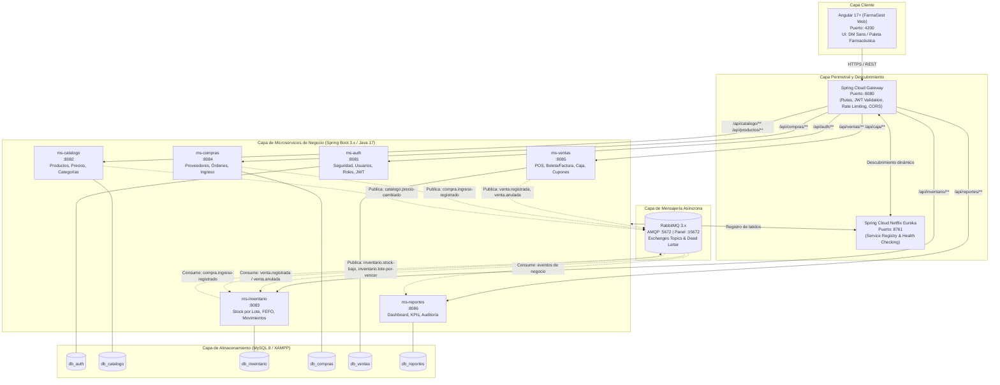

# 01. Arquitectura del Sistema — FarmaGest

## 1. Visión General y Contexto

**FarmaGest** es un sistema de gestión farmacéutica concebido para la botica **"Farma Ochenta"** (Ate, Lima, Perú), orientado a optimizar la operativa diaria de mostrador (POS), control estricto de inventarios farmacéuticos (lotes y vencimientos bajo política FEFO), compras, administración de caja, promociones comerciales y generación de analítica de negocio.

La solución se estructura bajo una **arquitectura de microservicios**, donde cada servicio opera de manera autónoma con su propio almacén de datos (patrón *Database-per-Service*), coordinando sus acciones de manera síncrona mediante un **API Gateway** hacia el exterior y de forma asíncrona mediante **RabbitMQ** para desacoplar procesos y garantizar alta disponibilidad y escalabilidad.

---

## 2. Diagrama de Arquitectura Global



---

## 3. Matriz de Puertos y Servicios

| Componente | Tipo | Puerto Contenedor / Local | Base de Datos | Responsabilidad |
|---|---|---|---|---|
| **farmagest-web** | Frontend SPA | `4200` | N/A | Interfaz Angular responsiva para mostrador (POS) y administración. |
| **api-gateway** | Perimetral | `8080` | N/A | Enrutamiento perimetral, verificación de JWT y headers de contexto (`X-User-Id`, `X-User-Roles`). |
| **eureka-server** | Infraestructura | `8761` | N/A | Registro dinámico de instancias backend. |
| **ms-auth** | Microservicio | `8081` | `db_auth` | Autenticación de usuarios, emisión y revocación de tokens JWT, control de roles y permisos. |
| **ms-catalogo** | Microservicio | `8082` | `db_catalogo` | Catálogo de productos médicos, presentaciones, categorías, laboratorios y política de precios. |
| **ms-inventario** | Microservicio | `8083` | `db_inventario` | Gestión de stock por lote, fechas de caducidad, reglas FEFO, mermas y auditoría de movimientos (Kardex). |
| **ms-compras** | Microservicio | `8084` | `db_compras` | Proveedores farmacéuticos, emisión de órdenes de compra y recepción física de mercadería. |
| **ms-ventas** | Microservicio | `8085` | `db_ventas` | Punto de Venta (POS), boletas/facturas, sesiones de caja, arqueos, descuentos, promociones y cupones. |
| **ms-reportes** | Microservicio | `8086` | `db_reportes` | Tableros de control ejecutivos (Dashboard), métricas diarias/mensuales y log consolidado de auditoría. |
| **MySQL Server** | Base de datos | `3306` | N/A | Motor relacional con 6 bases de datos independientes. |
| **phpMyAdmin** | Administración DB | `8090` | N/A | Visor web administrativo de bases de datos. |
| **RabbitMQ AMQP** | Message Broker | `5672` | N/A | Canal de comunicación de mensajería asíncrona. |
| **RabbitMQ Management** | Consola Web | `15672` | N/A | Monitoreo de colas, exchanges y dead-letters. |

---

## 4. Principios y Decisiones Arquitectónicas

### 4.1 Desacoplamiento y Base de Datos por Servicio
Ningún microservicio tiene acceso directo a la base de datos de otro microservicio. Toda comunicación síncrona se minimiza al máximo:
- La información de catálogo (ej. nombre de producto, código de barras) que requiere el POS se consulta vía Gateway hacia `ms-catalogo` o se replica en los eventos para evitar el antipatrón de llamadas en cascada (*chatty services*).
- Las transacciones de venta actualizan inmediatamente `db_ventas` y disparan un evento `venta.registrada` a RabbitMQ; `ms-inventario` escucha dicho evento para rebajar los lotes mediante la estrategia FEFO.

### 4.2 Consistencia Eventual y Manejo de Fallos (Patrón Saga Coreografiada)
1. **Registro de Venta**:
   - `ms-ventas` genera la venta con estado `COMPLETADA` y publica `venta.registrada`.
   - `ms-inventario` consume el evento y descuenta los lotes correspondientes.
2. **Control de Errores e Idempotencia**:
   - Cada evento contiene un `eventId` único y un `timestamp`.
   - Los consumidores mantienen una tabla de eventos procesados para garantizar **idempotencia** ante reenvíos.
   - En caso de fallo irrecuperable en un consumidor, el mensaje se despacha a la cola de reintentos (`farmagest.retry`) con un límite de 3 intentos espaciados por un *backoff* exponencial. Si persiste el fallo, se desvía a la cola de rechazo definitivo (**Dead Letter Queue - DLQ** `farmagest.dlq`) y genera una alerta en `ms-reportes`.

### 4.3 Estrategia Multi-Sucursal Preparada
Aunque la versión 1 opera en una única sede física (*Botica Farma Ochenta - Ate*), la totalidad de las tablas de datos operativas integran la columna:
```sql
sucursal_id INT NOT NULL DEFAULT 1
```
- Cada petición autenticada porta en el token JWT o en el header `X-Sucursal-Id` la sucursal activa.
- Los filtros de inventario, sesiones de caja y ventas ejecutan partición lógica por `sucursal_id`.
- La transición a múltiples sedes no requerirá refactorización de esquemas ni migraciones estructurales.

### 4.4 Seguridad Perimetral y de Microservicios
- **API Gateway**: Actúa como *OAuth2 Resource Server / JWT Validator*. Filtra tokens expirados o alterados antes de reenviar el tráfico interno.
- **Propagación de Identidad**: El Gateway inyecta headers confiables hacia la red interna:
  - `X-User-Id`: ID único del usuario autenticado.
  - `X-Username`: Nombre de usuario del operador.
  - `X-User-Roles`: Lista de roles (`ROLE_ADMIN`, `ROLE_VENDEDOR`, `ROLE_ALMACENERO`).
  - `X-Sucursal-Id`: Identificador de la sucursal de operación.
- **Validación Local (`@PreAuthorize`)**: Cada microservicio mantiene un filtro de seguridad interno que verifica la integridad de estos headers o valida el token JWT con la clave pública compartida, denegando el acceso (HTTP 403 Forbidden) si el rol no tiene privilegio.

---

## 5. Estrategia de Migraciones con Flyway

Cada microservicio gestiona el ciclo de vida de su base de datos de manera independiente mediante **Flyway**:
- Ubicación: `src/main/resources/db/migration/`
- Nomenclatura:
  - `V1__init_schema.sql`: Estructura base de tablas, índices y restricciones.
  - `V2__seed_initial_data.sql`: Datos semilla esenciales (roles, tipos de movimiento, categorías maestras).
  - `V3__dev_mock_data.sql`: Datos de prueba cargados exclusivamente bajo el perfil de ejecución `spring.profiles.active=dev`.
- No se permiten modificaciones directas sobre las bases de datos en phpMyAdmin; cualquier cambio al modelo debe implementarse mediante un nuevo script de versión (`V4__...sql`).
