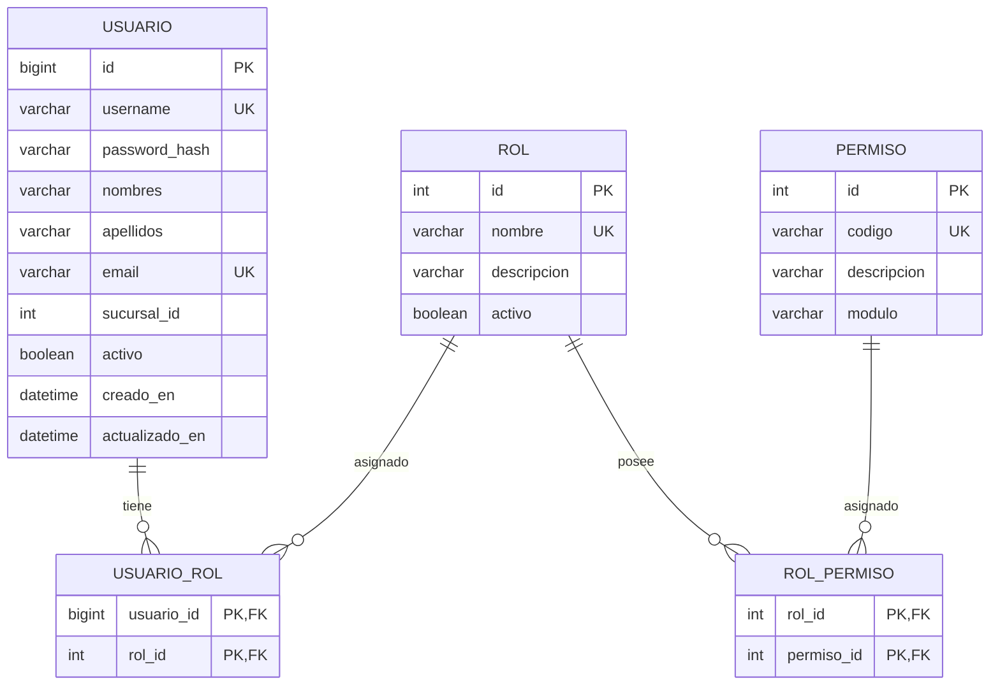
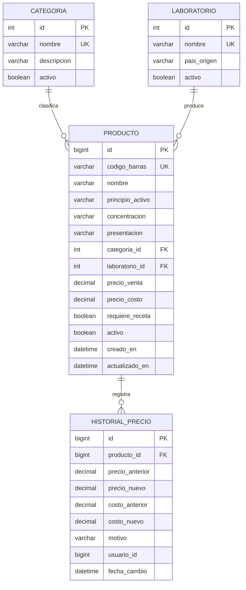
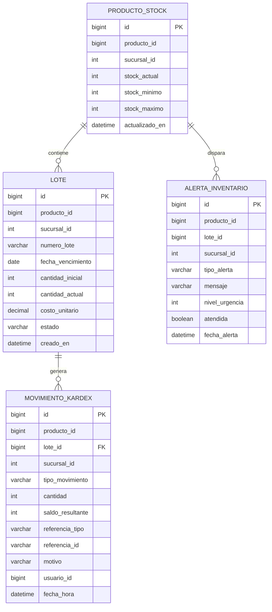
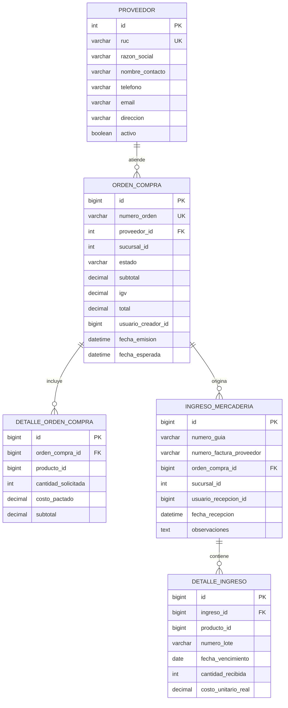
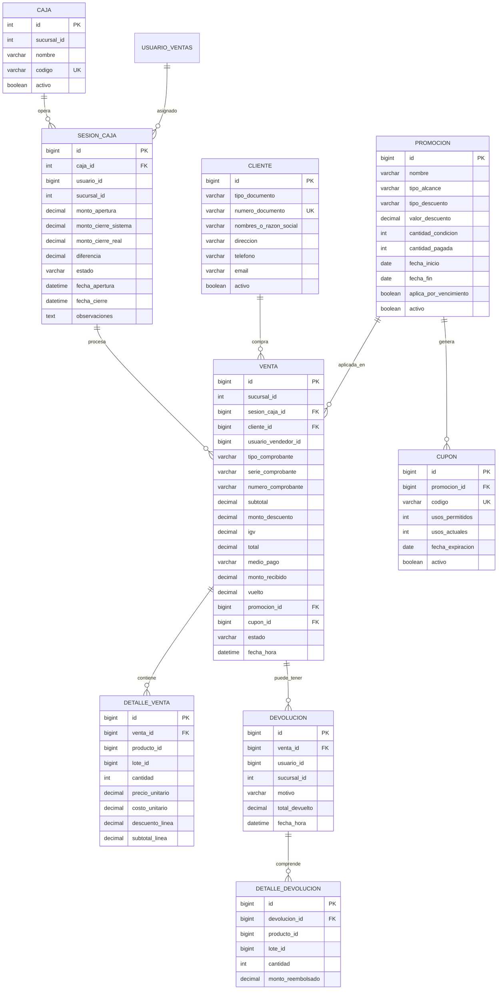
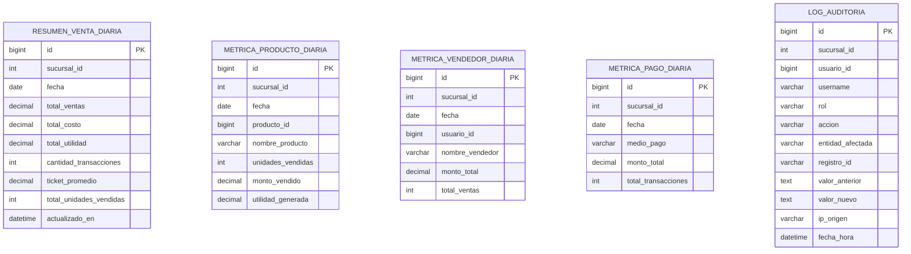

# 02. Modelo de Datos por Microservicio — FarmaGest

Este documento define la estructura de base de datos relacional para **MySQL 8.x**, organizada bajo el patrón **Database-per-Service**. Cada base de datos es autónoma y aislada.

---

## 1. `db_auth` (Microservicio `ms-auth`)

Gestiona credenciales, roles, permisos y estados de los operadores del sistema.

### 1.1 Diagrama Entidad-Relación

### 1.2 Diccionario de Tablas (`db_auth`)

#### Tabla `usuario`
| Columna | Tipo | Nulo | Descripción |
|---|---|---|---|
| `id` | BIGINT AUTO_INCREMENT | NO | Llave primaria |
| `username` | VARCHAR(50) | NO | Identificador único de acceso (ej. `admin`, `vendedor1`) |
| `password_hash` | VARCHAR(255) | NO | Hash de contraseña con BCrypt (cost factor 12) |
| `nombres` | VARCHAR(100) | NO | Nombres del empleado |
| `apellidos` | VARCHAR(100) | NO | Apellidos del empleado |
| `email` | VARCHAR(100) | NO | Correo electrónico de contacto |
| `sucursal_id` | INT | NO | Sucursal a la que pertenece (Default `1`) |
| `activo` | BOOLEAN | NO | Baja lógica (`true` = activo, `false` = deshabilitado) |
| `creado_en` | DATETIME | NO | Marca de tiempo de registro |
| `actualizado_en` | DATETIME | SÍ | Marca de tiempo de última actualización |

#### Tabla `rol`
| Columna | Tipo | Nulo | Descripción |
|---|---|---|---|
| `id` | INT AUTO_INCREMENT | NO | Llave primaria |
| `nombre` | VARCHAR(50) | NO | Nombre único del rol (`ROLE_ADMINISTRADOR`, `ROLE_VENDEDOR`, `ROLE_ALMACENERO`) |
| `descripcion` | VARCHAR(255) | SÍ | Descripción de las responsabilidades |
| `activo` | BOOLEAN | NO | Estado de vigencia del rol |

#### Tabla `permiso`
| Columna | Tipo | Nulo | Descripción |
|---|---|---|---|
| `id` | INT AUTO_INCREMENT | NO | Llave primaria |
| `codigo` | VARCHAR(60) | NO | Código de autorización (ej. `VENTA_CREAR`, `PRODUCTO_EDITAR`, `STOCK_AJUSTAR`) |
| `descripcion` | VARCHAR(255) | SÍ | Detalle del permiso |
| `modulo` | VARCHAR(50) | NO | Agrupador funcional (`POS`, `INVENTARIO`, `CATALOGO`, `CAJA`, `REPORTES`) |

#### Tablas Intermedias: `usuario_rol` y `rol_permiso`
- `usuario_rol`: Claves foráneas compuestas (`usuario_id`, `rol_id`).
- `rol_permiso`: Claves foráneas compuestas (`rol_id`, `permiso_id`).

---

## 2. `db_catalogo` (Microservicio `ms-catalogo`)

Almacena la información maestra de medicamentos, productos comerciales, categorías, laboratorios y el historial de cambios de precio.

### 2.1 Diagrama Entidad-Relación

### 2.2 Diccionario de Tablas (`db_catalogo`)

#### Tabla `producto`
| Columna | Tipo | Nulo | Descripción |
|---|---|---|---|
| `id` | BIGINT AUTO_INCREMENT | NO | Llave primaria |
| `codigo_barras` | VARCHAR(30) | NO | Código EAN-13 / GS1 único para escáner POS |
| `nombre` | VARCHAR(150) | NO | Nombre comercial (ej. "Paracetamol 500 mg") |
| `principio_activo` | VARCHAR(150) | SÍ | Nombre genérico / DCI (ej. "Paracetamol") |
| `concentracion` | VARCHAR(50) | SÍ | Potencia o concentración (ej. "500 mg", "1 g") |
| `presentacion` | VARCHAR(100) | NO | Formato físico (ej. "Tableta", "Cápsula", "Jarabe 120 ml") |
| `categoria_id` | INT | NO | FK a `categoria` |
| `laboratorio_id` | INT | NO | FK a `laboratorio` |
| `precio_venta` | DECIMAL(10,2) | NO | Precio al público en Soles (PEN) |
| `precio_costo` | DECIMAL(10,2) | NO | Costo de adquisición actual en Soles (PEN) |
| `requiere_receta` | BOOLEAN | NO | `true` si es medicamento ético o con prescripción médica |
| `activo` | BOOLEAN | NO | Baja lógica (`true` = activo, `false` = descontinuado) |
| `creado_en` | DATETIME | NO | Fecha de creación del registro |
| `actualizado_en` | DATETIME | SÍ | Última actualización |

#### Tabla `historial_precio`
| Columna | Tipo | Nulo | Descripción |
|---|---|---|---|
| `id` | BIGINT AUTO_INCREMENT | NO | Llave primaria |
| `producto_id` | BIGINT | NO | FK a `producto` |
| `precio_anterior` | DECIMAL(10,2) | NO | Precio de venta previo |
| `precio_nuevo` | DECIMAL(10,2) | NO | Nuevo precio de venta establecido |
| `costo_anterior` | DECIMAL(10,2) | NO | Costo anterior |
| `costo_nuevo` | DECIMAL(10,2) | NO | Nuevo costo asignado |
| `motivo` | VARCHAR(255) | SÍ | Razón del cambio (inflación de proveedor, campaña comercial, etc.) |
| `usuario_id` | BIGINT | NO | ID del administrador que autorizó el cambio |
| `fecha_cambio` | DATETIME | NO | Marca de tiempo del cambio |

---

## 3. `db_inventario` (Microservicio `ms-inventario`)

Centraliza la existencia física de mercadería por lote, control de caducidad (FEFO), alertas tempranas de desabastecimiento o vencimiento, y la trazabilidad de movimientos (Kardex).

### 3.1 Diagrama Entidad-Relación

### 3.2 Diccionario de Tablas (`db_inventario`)

#### Tabla `producto_stock`
| Columna | Tipo | Nulo | Descripción |
|---|---|---|---|
| `id` | BIGINT AUTO_INCREMENT | NO | Llave primaria |
| `producto_id` | BIGINT | NO | ID del producto (referencia lógica a `ms-catalogo`) |
| `sucursal_id` | INT | NO | Sucursal física (Default `1`) |
| `stock_actual` | INT | NO | Sumatoria consolidada de stock de todos los lotes activos |
| `stock_minimo` | INT | NO | Umbral mínimo para disparo de alerta de reposición |
| `stock_maximo` | INT | SÍ | Capacidad de almacenamiento sugerida |
| `actualizado_en` | DATETIME | NO | Marca de tiempo de la última variación |
- *Índice Único:* `(producto_id, sucursal_id)`

#### Tabla `lote`
| Columna | Tipo | Nulo | Descripción |
|---|---|---|---|
| `id` | BIGINT AUTO_INCREMENT | NO | Llave primaria |
| `producto_id` | BIGINT | NO | ID del producto referenciado |
| `sucursal_id` | INT | NO | Sucursal donde reside el lote físico |
| `numero_lote` | VARCHAR(50) | NO | Código de lote impreso por el laboratorio fabricante |
| `fecha_vencimiento` | DATE | NO | Fecha límite de comercialización |
| `cantidad_inicial` | INT | NO | Cantidad ingresada al recibir la compra |
| `cantidad_actual` | INT | NO | Cantidad disponible disponible para venta |
| `costo_unitario` | DECIMAL(10,2) | NO | Costo neto de compra por unidad de este lote |
| `estado` | VARCHAR(20) | NO | `DISPONIBLE`, `AGOTADO`, `VENCIDO`, `EN_CUARENTENA` |
| `creado_en` | DATETIME | NO | Fecha de registro de ingreso |
- *Índice para FEFO:* `(producto_id, sucursal_id, estado, fecha_vencimiento ASC)`

#### Tabla `movimiento_kardex`
| Columna | Tipo | Nulo | Descripción |
|---|---|---|---|
| `id` | BIGINT AUTO_INCREMENT | NO | Llave primaria |
| `producto_id` | BIGINT | NO | ID del producto afectado |
| `lote_id` | BIGINT | SÍ | ID del lote específico (FK a `lote`) |
| `sucursal_id` | INT | NO | Sucursal |
| `tipo_movimiento` | VARCHAR(30) | NO | `INGRESO_COMPRA`, `SALIDA_VENTA`, `DEVOLUCION_CLIENTE`, `AJUSTE_MERMA`, `AJUSTE_SOBRANTE` |
| `cantidad` | INT | NO | Unidades movidas (positivo para ingresos, negativo para egresos) |
| `saldo_resultante` | INT | NO | Stock resultante en la sucursal tras la operación |
| `referencia_tipo` | VARCHAR(30) | SÍ | `VENTA`, `COMPRA`, `AJUSTE_MANUAL` |
| `referencia_id` | VARCHAR(50) | SÍ | Número o identificador del documento origen |
| `motivo` | VARCHAR(255) | SÍ | Justificación del movimiento (ej. "Frasco roto en estante") |
| `usuario_id` | BIGINT | NO | ID del usuario operador |
| `fecha_hora` | DATETIME | NO | Marca de tiempo exacta |

#### Tabla `alerta_inventario`
| Columna | Tipo | Nulo | Descripción |
|---|---|---|---|
| `id` | BIGINT AUTO_INCREMENT | NO | Llave primaria |
| `producto_id` | BIGINT | NO | ID de producto |
| `lote_id` | BIGINT | SÍ | Lote en riesgo (si aplica) |
| `sucursal_id` | INT | NO | Sucursal |
| `tipo_alerta` | VARCHAR(40) | NO | `STOCK_MINIMO`, `VENCIMIENTO_30_DIAS`, `VENCIMIENTO_60_DIAS`, `VENCIDO` |
| `mensaje` | VARCHAR(255) | NO | Mensaje legible para el operador |
| `nivel_urgencia` | INT | NO | `1`: Informativo, `2`: Advertencia, `3`: Crítico |
| `atendida` | BOOLEAN | NO | `false` si sigue activa, `true` si fue revisada |
| `fecha_alerta` | DATETIME | NO | Fecha de generación |

---

## 4. `db_compras` (Microservicio `ms-compras`)

Registra proveedores, gestión de órdenes de abastecimiento y la recepción física de mercadería.

### 4.1 Diagrama Entidad-Relación

### 4.2 Diccionario de Tablas (`db_compras`)

#### Tabla `proveedor`
| Columna | Tipo | Nulo | Descripción |
|---|---|---|---|
| `id` | INT AUTO_INCREMENT | NO | Llave primaria |
| `ruc` | VARCHAR(11) | NO | RUC de 11 dígitos de la empresa proveedora (UK) |
| `razon_social` | VARCHAR(150) | NO | Nombre legal o comercial |
| `nombre_contacto` | VARCHAR(100) | SÍ | Nombre de ejecutivo de ventas |
| `telefono` | VARCHAR(30) | SÍ | Teléfono de contacto |
| `email` | VARCHAR(100) | SÍ | Correo para envío de órdenes |
| `direccion` | VARCHAR(200) | SÍ | Dirección fiscal / almacén |
| `activo` | BOOLEAN | NO | Baja lógica |

#### Tabla `orden_compra`
| Columna | Tipo | Nulo | Descripción |
|---|---|---|---|
| `id` | BIGINT AUTO_INCREMENT | NO | Llave primaria |
| `numero_orden` | VARCHAR(30) | NO | Código de orden correlativo (ej. `OC-2026-0001`) |
| `proveedor_id` | INT | NO | FK a `proveedor` |
| `sucursal_id` | INT | NO | Sucursal destino |
| `estado` | VARCHAR(20) | NO | `PENDIENTE`, `APROBADA`, `RECIBIDA_PARCIAL`, `RECIBIDA_TOTAL`, `CANCELADA` |
| `subtotal` | DECIMAL(10,2) | NO | Monto sin IGV |
| `igv` | DECIMAL(10,2) | NO | Impuesto General a las Ventas (18%) |
| `total` | DECIMAL(10,2) | NO | Monto total en PEN |
| `usuario_creador_id`| BIGINT | NO | Usuario que generó la orden |
| `fecha_emision` | DATETIME | NO | Fecha de emisión |
| `fecha_esperada` | DATE | SÍ | Fecha pactada de llegada |

#### Tabla `ingreso_mercaderia` y `detalle_ingreso`
Al recibir físicamente los bultos en almacén:
- `ingreso_mercaderia` almacena el comprobante del proveedor (Guía de Remisión y Factura física).
- `detalle_ingreso` registra cada medicamento recibido indicando obligatoriamente **`numero_lote`**, **`fecha_vencimiento`**, **`cantidad_recibida`** y **`costo_unitario_real`**.
- El registro exitoso de esta transacción dispara el evento `compra.ingreso-registrado` hacia RabbitMQ.

---

## 5. `db_ventas` (Microservicio `ms-ventas`)

Encargado del flujo de Punto de Venta (POS), control de sesiones y turnos de caja, clientes, motor de descuentos, promociones y devoluciones.

### 5.1 Diagrama Entidad-Relación

### 5.2 Diccionario de Tablas (`db_ventas`)

#### Tabla `sesion_caja`
| Columna | Tipo | Nulo | Descripción |
|---|---|---|---|
| `id` | BIGINT AUTO_INCREMENT | NO | Llave primaria |
| `caja_id` | INT | NO | FK a `caja` |
| `usuario_id` | BIGINT | NO | Identificador del vendedor asignado al turno |
| `sucursal_id` | INT | NO | Sucursal |
| `monto_apertura` | DECIMAL(10,2) | NO | Saldo en efectivo para dar cambio inicial |
| `monto_cierre_sistema`| DECIMAL(10,2) | SÍ | Total calculado por el sistema en efectivo al cierre |
| `monto_cierre_real` | DECIMAL(10,2) | SÍ | Arqueo físico ingresado por el vendedor |
| `diferencia` | DECIMAL(10,2) | SÍ | Faltante o sobrante (`real - sistema`) |
| `estado` | VARCHAR(20) | NO | `ABIERTA`, `CERRADA`, `ARQUEADA` |
| `fecha_apertura` | DATETIME | NO | Apertura del turno |
| `fecha_cierre` | DATETIME | SÍ | Cierre del turno |
| `observaciones` | TEXT | SÍ | Comentarios de arqueo |

#### Tabla `promocion`
| Columna | Tipo | Nulo | Descripción |
|---|---|---|---|
| `id` | BIGINT AUTO_INCREMENT | NO | Llave primaria |
| `nombre` | VARCHAR(150) | NO | Nombre de campaña (ej. "Lleva 3 Paga 2 en Vitaminas", "15% Vitamina C") |
| `tipo_alcance` | VARCHAR(30) | NO | `POR_PRODUCTO`, `POR_CATEGORIA`, `POR_MONTO_TOTAL`, `POR_VENCIMIENTO_PROXIMO` |
| `tipo_descuento` | VARCHAR(20) | NO | `PORCENTAJE`, `MONTO_FIJO`, `N_X_M` |
| `valor_descuento` | DECIMAL(10,2) | SÍ | Porcentaje (ej. 15.00) o monto en soles |
| `cantidad_condicion` | INT | SÍ | Para combos 2x1 (condición = 2) |
| `cantidad_pagada` | INT | SÍ | Para combos 2x1 (pagada = 1) |
| `fecha_inicio` | DATE | NO | Fecha de inicio de vigencia |
| `fecha_fin` | DATE | NO | Fecha final de vigencia |
| `aplica_por_vencimiento`| BOOLEAN | NO | Si fue creada automáticamente para liquidar lotes próximos |
| `activo` | BOOLEAN | NO | Estado de activación |

#### Tabla `venta`
| Columna | Tipo | Nulo | Descripción |
|---|---|---|---|
| `id` | BIGINT AUTO_INCREMENT | NO | Llave primaria |
| `sucursal_id` | INT | NO | Sucursal (Default `1`) |
| `sesion_caja_id` | BIGINT | NO | FK a `sesion_caja` |
| `cliente_id` | BIGINT | SÍ | FK a `cliente` (Nulo si es cliente genérico sin registrar) |
| `usuario_vendedor_id` | BIGINT | NO | Vendedor que emitió la venta |
| `tipo_comprobante` | VARCHAR(20) | NO | `BOLETA`, `FACTURA`, `NOTA_VENTA` |
| `serie_comprobante` | VARCHAR(10) | NO | Ej. `B001`, `F001` |
| `numero_comprobante` | VARCHAR(20) | NO | Correlativo único por serie (ej. `00001245`) |
| `subtotal` | DECIMAL(10,2) | NO | Total sin impuestos |
| `monto_descuento` | DECIMAL(10,2) | NO | Total deducido por promociones/cupones |
| `igv` | DECIMAL(10,2) | NO | Impuesto (18%) |
| `total` | DECIMAL(10,2) | NO | Monto final a cobrar en PEN |
| `medio_pago` | VARCHAR(30) | NO | `EFECTIVO`, `TARJETA`, `YAPE_PLIN` |
| `monto_recibido` | DECIMAL(10,2) | SÍ | Efectivo entregado por el cliente |
| `vuelto` | DECIMAL(10,2) | SÍ | Vuelto devuelto |
| `promocion_id` | BIGINT | SÍ | FK a `promocion` (si aplicó regla general) |
| `cupon_id` | BIGINT | SÍ | FK a `cupon` (si se digitó un código) |
| `estado` | VARCHAR(20) | NO | `COMPLETADA`, `ANULADA` (no se elimina físicamente) |
| `fecha_hora` | DATETIME | NO | Momento exacto de emisión |

#### Tabla `detalle_venta`
| Columna | Tipo | Nulo | Descripción |
|---|---|---|---|
| `id` | BIGINT AUTO_INCREMENT | NO | Llave primaria |
| `venta_id` | BIGINT | NO | FK a `venta` |
| `producto_id` | BIGINT | NO | ID de producto vendido |
| `lote_id` | BIGINT | NO | Lote asignado según FEFO |
| `cantidad` | INT | NO | Cantidad vendida |
| `precio_unitario` | DECIMAL(10,2) | NO | Precio regular de catálogo |
| `costo_unitario` | DECIMAL(10,2) | NO | Costo del lote asignado (usado para calcular márgenes y evitar venta bajo costo) |
| `descuento_linea` | DECIMAL(10,2) | NO | Descuento aplicado en esta línea |
| `subtotal_linea` | DECIMAL(10,2) | NO | Monto neto a pagar por la línea |

---

## 6. `db_reportes` (Microservicio `ms-reportes`)

Almacena proyecciones analíticas y agregaciones precalculadas basadas en eventos para garantizar que las consultas del **Dashboard Administrador** respondan en menos de 50 ms sin impactar las bases transaccionales.

### 6.1 Diagrama Entidad-Relación

### 6.2 Diccionario de Tablas (`db_reportes`)

#### Tabla `resumen_venta_diaria`
| Columna | Tipo | Nulo | Descripción |
|---|---|---|---|
| `id` | BIGINT AUTO_INCREMENT | NO | Llave primaria |
| `sucursal_id` | INT | NO | Sucursal |
| `fecha` | DATE | NO | Día del balance |
| `total_ventas` | DECIMAL(12,2) | NO | Suma de todas las ventas del día |
| `total_costo` | DECIMAL(12,2) | NO | Suma de los costos de los productos vendidos |
| `total_utilidad` | DECIMAL(12,2) | NO | `total_ventas - total_costo` |
| `cantidad_transacciones`| INT | NO | Número de boletas/facturas generadas |
| `ticket_promedio` | DECIMAL(10,2) | NO | `total_ventas / cantidad_transacciones` |
| `total_unidades_vendidas`| INT | NO | Suma de unidades de medicamentos despachadas |
| `actualizado_en` | DATETIME | NO | Marca de tiempo del último evento procesado |
- *Índice Único:* `(sucursal_id, fecha)`

#### Tabla `log_auditoria`
| Columna | Tipo | Nulo | Descripción |
|---|---|---|---|
| `id` | BIGINT AUTO_INCREMENT | NO | Llave primaria |
| `sucursal_id` | INT | NO | Sucursal donde se ejecutó la acción |
| `usuario_id` | BIGINT | NO | ID del usuario autor |
| `username` | VARCHAR(50) | NO | Nombre de usuario |
| `rol` | VARCHAR(50) | NO | Rol en el momento del evento |
| `accion` | VARCHAR(50) | NO | `VENTA_ANULADA`, `CAMBIO_PRECIO`, `AJUSTE_STOCK`, `MODIFICACION_USUARIO` |
| `entidad_afectada`| VARCHAR(50) | NO | `VENTA`, `PRODUCTO`, `LOTE`, `USUARIO` |
| `registro_id` | VARCHAR(50) | NO | ID o correlativo afectado |
| `valor_anterior` | TEXT | SÍ | Snapshot en JSON antes del cambio |
| `valor_nuevo` | TEXT | SÍ | Snapshot en JSON después del cambio |
| `ip_origen` | VARCHAR(45) | SÍ | Dirección IP |
| `fecha_hora` | DATETIME | NO | Marca temporal inmutable |
