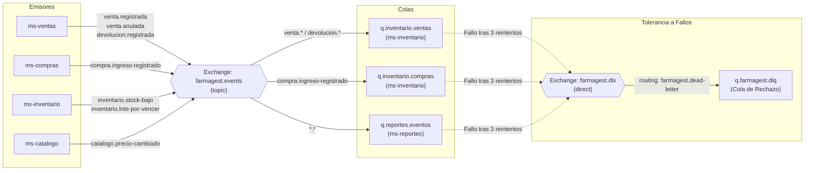

# 04. Catálogo de Mensajería y Eventos — RabbitMQ

Este documento especifica la arquitectura orientada a eventos (**Event-Driven Architecture**) de FarmaGest sobre **RabbitMQ 3.x**, definiendo los intercambiadores (*exchanges*), colas (*queues*), llaves de enrutamiento (*routing keys*), contratos de carga útil (*JSON payloads*) y la estrategia de tolerancia a fallos (*Dead Letter Queue*).

---

## 1. Topología de Mensajería en RabbitMQ

### 1.1 Exchanges Principales
- **Exchange Principal de Negocio**: `farmagest.events` (Tipo: `topic`, Durable: `true`)
  - Enruta todos los eventos de dominio emitidos por los microservicios hacia las colas suscritas.
- **Dead-Letter Exchange (DLX)**: `farmagest.dlx` (Tipo: `direct`, Durable: `true`)
  - Recibe los mensajes que agotaron sus reintentos máximos o que fueron rechazados por error irrecuperable.

### 1.2 Diagrama de Enrutamiento de Eventos



---

## 2. Definición de Colas y Suscripciones

| Cola | Microservicio Consumidor | Binding Key | Propósito | Configuración DLX |
|---|---|---|---|---|
| `q.inventario.ventas` | `ms-inventario` | `venta.registrada`<br>`venta.anulada`<br>`devolucion.registrada` | Descontar o reponer stock por lotes según FEFO | `x-dead-letter-exchange: farmagest.dlx`<br>`x-dead-letter-routing-key: farmagest.dead-letter` |
| `q.inventario.compras` | `ms-inventario` | `compra.ingreso-registrado` | Crear o incrementar lotes y saldos en Kardex | `x-dead-letter-exchange: farmagest.dlx`<br>`x-dead-letter-routing-key: farmagest.dead-letter` |
| `q.reportes.eventos` | `ms-reportes` | `venta.*`<br>`compra.*`<br>`inventario.*`<br>`catalogo.*` | Calcular métricas diarias, actualizar tableros y bitácora de auditoría | `x-dead-letter-exchange: farmagest.dlx`<br>`x-dead-letter-routing-key: farmagest.dead-letter` |
| `q.farmagest.dlq` | Monitoreo / Alertas | `farmagest.dead-letter` | Almacén de mensajes erróneos para inspección manual y auditoría | Sin DLX |

---

## 3. Estructura Estándar de Cabecera de Evento

Todos los eventos viajan en formato JSON con la siguiente envoltura común (*Envelope*):

```json
{
  "eventId": "a7b3c2d1-4e5f-6a7b-8c9d-0e1f2a3b4c5d",
  "eventType": "venta.registrada",
  "timestamp": "2026-10-18T16:15:30.123Z",
  "sourceService": "ms-ventas",
  "sucursalId": 1,
  "payload": { ... }
}
```

---

## 4. Contratos de Carga Útil (Payloads)

### 4.1 Evento `venta.registrada`
- **Emisor**: `ms-ventas`
- **Consumidores**: `ms-inventario`, `ms-reportes`
- **Routing Key**: `venta.registrada`
- **Payload**:
```json
{
  "ventaId": 1042,
  "sucursalId": 1,
  "tipoComprobante": "BOLETA",
  "serieComprobante": "B001",
  "numeroComprobante": "00001042",
  "fechaHora": "2026-10-18T16:15:00Z",
  "usuarioVendedorId": 2,
  "nombreVendedor": "Carlos Gómez",
  "medioPago": "EFECTIVO",
  "subtotal": 25.00,
  "descuentoTotal": 2.50,
  "total": 22.50,
  "promocionId": 1,
  "cuponId": null,
  "items": [
    {
      "productoId": 1,
      "nombreProducto": "Paracetamol 500 mg",
      "loteId": 4,
      "cantidad": 5,
      "precioUnitario": 0.50,
      "costoUnitario": 0.22,
      "descuento": 0.00,
      "subtotal": 2.50
    },
    {
      "productoId": 7,
      "nombreProducto": "Alcohol 70° 250 ml",
      "loteId": 9,
      "cantidad": 4,
      "precioUnitario": 6.00,
      "costoUnitario": 3.80,
      "descuento": 2.50,
      "subtotal": 20.00
    }
  ]
}
```
- **Acción en `ms-inventario`**: Descuenta las cantidades de los lotes especificados y registra el movimiento de salida en el Kardex.
- **Acción en `ms-reportes`**: Incrementa acumuladores diarios, ticket promedio, ventas por vendedor y ventas por medio de pago.

---

### 4.2 Evento `venta.anulada` / `devolucion.registrada`
- **Emisor**: `ms-ventas`
- **Consumidores**: `ms-inventario`, `ms-reportes`
- **Routing Key**: `venta.anulada`
- **Payload**:
```json
{
  "ventaId": 1042,
  "sucursalId": 1,
  "usuarioAdminId": 1,
  "usernameAdmin": "admin",
  "motivo": "Devolución por error de digitación en mostrador",
  "fechaHoraAnulacion": "2026-10-18T16:30:00Z",
  "montoReembolsado": 22.50,
  "itemsReincorporar": [
    {
      "productoId": 1,
      "loteId": 4,
      "cantidad": 5
    },
    {
      "productoId": 7,
      "loteId": 9,
      "cantidad": 4
    }
  ]
}
```
- **Acción en `ms-inventario`**: Reincorpora la mercadería al lote de procedencia y anota en Kardex `DEVOLUCION_CLIENTE`.
- **Acción en `ms-reportes`**: Resta el importe de los reportes del día y añade entrada a `log_auditoria`.

---

### 4.3 Evento `compra.ingreso-registrado`
- **Emisor**: `ms-compras`
- **Consumidores**: `ms-inventario`
- **Routing Key**: `compra.ingreso-registrado`
- **Payload**:
```json
{
  "ingresoId": 88,
  "ordenCompraId": 105,
  "sucursalId": 1,
  "numeroGuia": "GR-001-002341",
  "numeroFactura": "F001-000456",
  "usuarioId": 3,
  "fechaRecepcion": "2026-10-18T10:00:00Z",
  "items": [
    {
      "productoId": 3,
      "numeroLote": "LOT-2026-AMX",
      "fechaVencimiento": "2027-12-31",
      "cantidad": 200,
      "costoUnitario": 1.20
    }
  ]
}
```
- **Acción en `ms-inventario`**: Inserta el registro del nuevo lote con su fecha de vencimiento y costo, actualiza el stock consolidado del producto y añade registro `INGRESO_COMPRA` en Kardex.

---

### 4.4 Evento `inventario.stock-bajo` y `inventario.lote-por-vencer`
- **Emisor**: `ms-inventario`
- **Consumidores**: `ms-reportes`
- **Routing Key**: `inventario.alerta`
- **Payload**:
```json
{
  "alertaId": 302,
  "tipoAlerta": "STOCK_MINIMO",
  "sucursalId": 1,
  "productoId": 2,
  "nombreProducto": "Ibuprofeno 400 mg",
  "stockActual": 8,
  "stockMinimo": 20,
  "nivelUrgencia": 2,
  "mensaje": "Stock actual (8) inferior al umbral mínimo permitido (20)"
}
```
- **Acción en `ms-reportes`**: Alimenta la sección "Alertas de inventario" del Dashboard del Administrador.

---

### 4.5 Evento `catalogo.precio-cambiado`
- **Emisor**: `ms-catalogo`
- **Consumidores**: `ms-reportes`
- **Routing Key**: `catalogo.precio-cambiado`
- **Payload**:
```json
{
  "productoId": 1,
  "nombreProducto": "Paracetamol 500 mg",
  "precioVentaAnterior": 0.50,
  "precioVentaNuevo": 0.60,
  "precioCostoAnterior": 0.22,
  "precioCostoNuevo": 0.25,
  "usuarioId": 1,
  "username": "admin",
  "motivo": "Reajuste de lista por incremento de proveedor",
  "fechaHora": "2026-10-18T14:00:00Z"
}
```
- **Acción en `ms-reportes`**: Inserta automáticamente un registro en `log_auditoria` para trazabilidad de márgenes y precios.

---

## 5. Estrategia de Reintentos y Manejo de Errores

1. **Idempotencia Obligatoria**:
   - Cada servicio consumidor mantiene una tabla interna `evento_procesado (event_id VARCHAR(64) PRIMARY KEY, fecha DATETIME)`.
   - Si un mensaje con el mismo `eventId` es recibido por segunda vez, se descarta confirmando el ACK a RabbitMQ para evitar duplicidad.
2. **Reintentos en Fallos Temporales**:
   - Se utiliza `SimpleRabbitListenerContainerFactory` con un `RetryTemplate` de Spring AMQP:
     - Máximo 3 intentos.
     - Intervalo inicial: 1000 ms, multiplicador 2.0 (Backoff exponencial).
3. **Desvío a Dead-Letter Queue (DLQ)**:
   - Al tercer fallo consecutivo, la excepción no controlada provoca un `BasicReject(requeue=false)`.
   - RabbitMQ enruta el mensaje automáticamente a través de `farmagest.dlx` hacia `q.farmagest.dlq`.
   - Un mecanismo de monitoreo notifica anomalías y permite reprocesar los mensajes una vez corregida la causa raíz.
